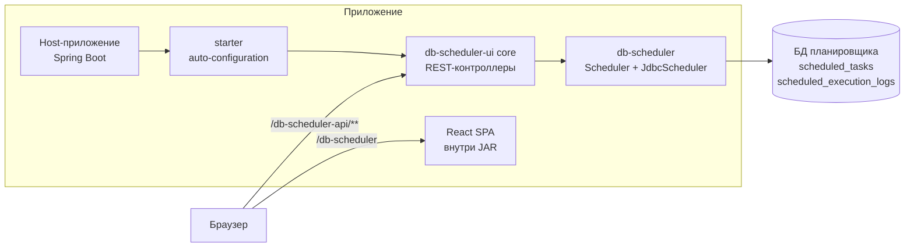
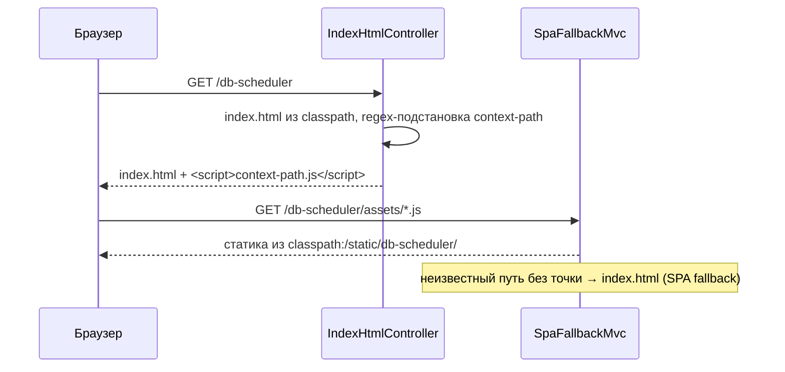

# Архитектура db-scheduler-ui (форк)

> Документ описывает текущую архитектуру проекта, потоки данных, точки расширения
> и накопленный бэклог. Язык интерфейса продукта — русский; план развития
> (локализация, создание заданий из UI, SQL-планировщик) — в конце документа.

## 1. Общая картина

Проект — веб-панель мониторинга и администрирования для библиотеки
[db-scheduler](https://github.com/kagkarlsson/db-scheduler) (v16.12.0).
db-scheduler хранит запланированные исполнения в таблицах БД (`scheduled_tasks`);
UI читает это хранилище и позволяет запускать/удалять/перепланировать экземпляры
задач. Сами *типы* задач (что исполнять) — это Java-код приложения:
`ExecutionHandler` регистрируется при старте как Spring-бин `Task<?>`.

## 2. Карта модулей

| Модуль | Назначение |
|---|---|
| `db-scheduler-ui` | Ядро: REST-контроллеры (`/db-scheduler-api/**`), сервисы (`TaskLogic`, `LogLogic`, `OverviewService`), DTO, подсистема логов (вендоринг rocketbase-io/db-scheduler-log, см. NOTICE). Внутри — собранный SPA в `src/main/resources/static/db-scheduler/`. |
| `db-scheduler-ui-starter` | Auto-configuration для Spring Boot 3 (`UiApiAutoConfiguration`, `DbSchedulerUiProperties`, SPA-роутинг, context-path). |
| `db-scheduler-ui-spring-boot-4-starter` | Побайтовый близнец boot3-стартера, отличаются двумя импортами (релокация пакетов в Boot 4). **Правило: любое изменение в одном стартере дублировать в другом.** |
| `db-scheduler-ui-frontend` | React 18 + TypeScript + Vite + Chakra UI 2 + React Query 4. ~4.5k LOC. |
| `example-app` / `-boot4` / `-webflux` | Демо-приложения (Boot 3 servlet / Boot 4 / WebFlux) с H2 и интеграционными smoke-тестами. |
| `example-app-shared` | Общие демо-задачи (`FailingTask`, `SpawnerTask`, `DynamicRecurringTaskExample`, …) и `TaskService`. |

**Сборка фронтенда в JAR**: корневой `pom.xml` на фазе `generate-resources`
выполняет `pnpm install --frozen-lockfile` + `pnpm run build`
(exec-maven-plugin), затем maven-resources-plugin копирует `dist/` в
`db-scheduler-ui/src/main/resources/static/db-scheduler/` (фаза `process-classes`).
Проверка без фронтенда: `./mvnw test -Pfast` (см. Verification ladder в CLAUDE.md).

## 3. REST API

Все эндпоинты под `/db-scheduler-api`, все с `@CrossOrigin` (аутентификация —
зона ответственности host-приложения, см. README «Security»):

| Контроллер | Эндпоинты | Условие включения |
|---|---|---|
| `TaskController` | `GET /tasks/all`, `/tasks/details`, `/tasks/poll` | всегда |
| `TaskAdminController` | `POST /tasks/rerun`, `/rerunGroup`, `/delete` | `read-only=false` |
| `OverviewController` | `GET /tasks/overview` | `overview=true` |
| `LogController` | `GET /logs/all`, `/logs/poll` | `history=true` |
| `ConfigController` | `GET /config` — флаги UI (`showHistory`, `showOverview`, `readOnly`) | всегда |
| `IndexHtmlController` | `GET /db-scheduler`, `/db-scheduler/index.html`, `/db-scheduler/js/context-path.js` | всегда |

Контракт ошибок для исключений контроллеров UI — RFC 7807 `ProblemDetail`
через `GlobalExceptionHandler` (`@RestControllerAdvice`, ограничен пакетом
контроллеров UI; наследуется от `ResponseEntityExceptionHandler`, поэтому
фреймворковые ошибки сохраняют корректный 4xx). Ошибки вне этого пакета
(несуществующие пути, 405) остаются в формате по умолчанию Spring Boot.

## 4. Потоки запросов

### 4.1 Загрузка SPA

Механизм context-path: бин `contextPath` = `server.servlet.context-path` +
`spring.mvc.servlet.path` + `db-scheduler-ui.context-path`; при заданном
последнем `PrefixedRequestMappingHandlerMapping` добавляет префикс только
контроллерам пакета `no.bekk.dbscheduler.ui.controller`.

### 4.2 Список задач и поллинг

`TaskController` → `TaskLogic`:

1. `Caching.getExecutionsFromCacheOrDB(refresh, scheduler)` — кэш снимка
   `scheduler.getScheduledExecutions()` (незабранные + забранные); кэши
   заменяются целиком (volatile-ссылки), читатели всегда видят целостный снапшот.
   Атомарность — по каждому кэшу отдельно: кэш статусов и кэш данных публикуются
   двумя независимыми записями, кратковременная «свежие статусы + старые данные»
   допустима (потребители читают только один из двух).
2. `TaskMapper` — маппинг `ScheduledExecution` → `TaskModel` (параллельные списки,
   см. бэклог), группировка по taskName с детерминированной сортировкой.
3. `QueryUtils` — поиск/фильтр/сортировка/пагинация в памяти (clamp: `pageNumber≥0`,
   `1≤size≤500`).

`GET /tasks/poll` сравнивает состояние БД с `taskStatusCache` (битовая строка
`"<failing><running>"`), возвращает дельты: новые задачи/падения/запуски,
прекратившие падения и завершившие выполнение.

### 4.3 История (подсистема логов)

`LogSchedulerListener` (наследует `AbstractSchedulerListener` db-scheduler) при
завершении каждого исполнения пишет строку в `scheduled_execution_logs`
через пул из 5 потоков с ограниченной очередью (10k, `CallerRunsPolicy`).
`LogLogic` читает таблицу `NamedParameterJdbcTemplate`-ом (диалект-зависимый
LIMIT: `TOP`/`FETCH NEXT`/`LIMIT`), id — Snowflake (epoch 43 бита / node 10 /
seq 10).

## 5. Модель данных

- `scheduled_tasks` — собственная таблица db-scheduler: `task_name`,
  `task_instance`, `task_data` (BLOB, **Java-сериализация** по умолчанию),
  `execution_time`, `picked`, `picked_by`, `consecutive_failures`,
  `last_success`, `last_failure`, `version`, `heartbeat_last_update`.
- `scheduled_execution_logs` — история (DDL по диалектам в `sql/log-table/`).
- Скрипты инициализации: `sql/core-tables/*`, `sql/log-table/*` (h2, postgresql,
  oracle, mysql, mssql).

## 6. Точки расширения

| Точка | Как использовать |
|---|---|
| `Task<?>` бины | Регистрация типов задач при старте (собирает db-scheduler boot-starter). **Динамическая регистрация определений не поддерживается** (`SchedulerBuilder.knownTasks` финальный). |
| `RecurringTaskWithPersistentSchedule<T extends ScheduleAndData>` | Определение зарегистрировано на старте, но каждый экземпляр несёт собственный `Schedule` в данных → создание cron-заданий в рантайме. Образцы: `DynamicRecurringTaskExample`, `TaskScheduleAndNoData` в example-app-shared. |
| `SchedulerClient` API | `schedule` / `scheduleIfNotExists` / `reschedule(id, time, newData)` / `cancel` — то, что уже используют `TaskLogic` и будущий SQL-модуль. |
| `DbSchedulerCustomizer` | Свой `DataSource`, `Serializer` и пр. UI уважает `customizer.dataSource()` для чтения логов. |
| `SchedulerListener`, `ExecutionInterceptor`, `FailureHandler` | События, обёртки исполнения, ретраи (экспоненциальная задержка). |
| `UiApiAutoConfiguration` | Все бины с `@ConditionalOnMissingBean` — переопределяемы. |

Хранилище планировщика и целевая БД выполнения разделены по построению:
`ExecutionHandler` — произвольный Java-код, может открывать любое другое
соединение.

## 7. Известные проблемы и бэклог

### Выявлено при ревью (осталось в бэклоге)

**Бэкенд**

1. Дедупликация boot3/boot4 стартеров (~8 классов копипасты) — вынести общий source set.
2. `TaskModel` — форма «параллельных списков» (7 списков, соответствие по индексу);
   мёртвые поля `lastHeartbeat` (никогда не заполняется) и `version` (всегда 0).
3. Java-десериализация `task_data` из таблицы логов (`LogModelRowMapper`) —
   gadget-chain риск, если таблицу может писать злоумышленник. Переход на JSON-сериализатор.
4. Имена таблиц/лимиты из конфигурации конкатенируются в SQL
   (`JdbcLogRepository`, `QueryBuilder`) — поверхность инъекции при враждебном конфиге;
   добавить whitelist идентификаторов.
5. Поллинг: `pollTasks`/`pollLogs` перечитывают всё целиком (нет delta-запроса,
   двойной кап `setMaxRows(500)` + `logLimit`).
6. `Snowflake` node-id = `hostname.hashCode() & 1023` — коллизии в контейнерных парках;
   перевод часов назад → `IllegalStateException`.
7. `indexHtml` regex-патчинг (`replaceAll("/db-scheduler", …)`) — хрупкий при
   context-path, содержащем `/db-scheduler` (двойной префикс).
8. `PrefixedRequestMappingHandlerMapping` подменяет общеприложенческий
   `RequestMappingHandlerMapping` при заданном context-path — может конфликтовать
   с MVC-кастомизацией host-приложения.
9. `LogLogic` конструктор оборачивает `SQLException` в голый `RuntimeException`.

**Фронтенд**

10. `OverviewPage.tsx` (~470 строк) и `useInfiniteTaskScrolling.ts` (~215 строк) —
    god-компонент/hook, разбить.
11. A11y: кликабельные `<Tr>` без keyboard/role/tabIndex; статус передан только
    цветом; read-only скрывает кнопки `visibility:hidden` (остаются в фокусе);
    нет error boundary.
12. Мёртвый код: `PaginationButtons.tsx`, неиспользуемый экспорт `styles/index.ts`,
    рудиментарный роут `/history/:taskName/:taskInstance`.
13. Дублирование: `API_BASE_URL` ×10, 401-редирект ×9, построение query-параметров ×5 —
    решается единым `apiClient` (запланирован в Фазе 3).
14. Устаревшие зависимости: React Query v4, Chakra v2, date-fns v2.
15. Тестов на фронте нет — vitest добавляется вместе с локализацией.
16. Артефакты сборки (`dist/`, `static/db-scheduler/assets/*`) закоммичены —
    hashes шумят в git.

### Уже исправлено (Фаза 0)

- `TaskLogic.pollTasks`: `stoppedFailing`/`finishedRunning` всегда 0 (параметры
  `int` передавались по значению) — теперь дельта возвращается и накапливается.
- `Caching`: гонки `clear()+addAll` на общем `ArrayList` — кэши заменены
  атомарно (`volatile` + whole-list swap).
- `QueryUtils.paginate`: отрицательный `pageNumber` → IndexOutOfBounds; теперь clamp.
- Дубль `getStatus` в `TaskLogic`/`Caching` — делегирование в `Caching`.
- `System.out.println` в `runTaskGroupNow` → slf4j.
- Добавлен `GlobalExceptionHandler` (RFC 7807), зарегистрирован в обоих стартерах.
- `TaskMapper.groupTasks`: недетерминированный порядок групп → сортировка.
- Фронт: `DotButton` delete теперь делает refetch; `config.ts` — fail-safe при
  недоступном `/config` (readOnly=true, без белого экрана).

## 8. SQL-движок заданий (`db-scheduler-ui-sql`)

Включается флагом `db-scheduler-ui.sql=true` (модуль на classpath + стартер).
Автоконфигурация `DbSchedulerUiSqlAutoConfiguration` (`AutoConfiguration.imports`,
работает и на Boot 3, и на Boot 4) поднимается после `DbSchedulerAutoConfiguration`
и требует наличия `SchedulerClient`.

### 8.1 Модель «задача = экземпляр планировщика»

Отдельной таблицы определений нет: задание — это запланированный экземпляр одной из
двух generic-задач, а полное определение лежит в `task_data` (Java-сериализация,
`SqlJobData implements ScheduleAndData`, `serialVersionUID = 1L` — только добавлять
поля, никогда не менять существующие):

| Задача | Тип | Смысл |
|---|---|---|
| `sql-script-task` | `RecurringTaskWithPersistentSchedule<SqlJobData>` | cron-задание; собственный cron у каждого экземпляра (`Schedules.cron(cron, zone)`) |
| `sql-script-once-task` | `OneTimeTask<SqlJobData>` | разовый запуск (`runAt` или сразу) |

Отсюда бесплатны: next-run/статусы в существующем UI, `consecutive_failures`,
отказоустойчивость планировщика. Правка = `reschedule(...)` с новыми данными,
удаление = `cancel`, «выполнить сейчас» = `reschedule` на `now`.

### 8.2 Хранилище (DDL в `sql/sql-jobs/`, 5 диалектов)

- `sql_job_connections` — реестр целевых БД: `dialect` (ORACLE|TRINO|IMPALA|MYSQL|MARIADB|
  POSTGRESQL|MSSQL|CLICKHOUSE|GENERIC),
  `jdbc_url`, `driver_class`, `username`, `password` (шифр `enc:v1:AES-GCM`, ключ
  `db-scheduler-ui.sql.encryption-key`; без ключа — plaintext + WARNING на старте),
  `properties_json` (доп. свойства драйверу). Пароль никогда не отдаётся наружу
  (в DTO только `passwordSet`).
- `sql_job_executions` — история: снапшот скрипта, время, `statements_executed`,
  `rows_affected`, `rows_capped`, `duration_ms`, `error_*`, `triggered_by`
  (SCHEDULE|MANUAL). id — snowflake-подобный `IdGenerator` (time<<20|node<<10|seq).

### 8.3 Исполнение (`SqlJobExecutor`)

`autoCommit=true` (у Trino/Impala нет транзакций; эффект каждого statement сохраняется);
`SqlScriptSplitter` режет по `;` вне кавычек/комментариев (PL/SQL — маркер `--@no-split`
первой строкой); `setQueryTimeout` + watchdog `Statement.cancel()` через timeout+5s
(Hive/Impala таймаут игнорируют); SELECT считается стримингом с ограничением
`max-rows-per-statement` (по умолчанию 10M, ставится `rows_capped`). Строка истории
пишется всегда (и при успехе, и при отказе), затем исключение пробрасывается —
db-scheduler сам ведёт счётчик провалов, падающее задание видно в общем списке.
Пулы Hikari по соединению (pool=2), ленивые, evict при update/delete
(`ConnectionPoolManager`). JDBC-драйверы намеренно НЕ в pom (ojdbc11/trino-jdbc/
hive-jdbc, а также postgresql/mariadb-java-client/mssql-jdbc/clickhouse-jdbc —
«принесите сами»), `Class.forName` даёт внятную ошибку.

### 8.4 REST (`/db-scheduler-api`)

| Эндпоинт | Метод | Примечание |
|---|---|---|
| `/sql-jobs` | GET | список (cron, next run, последний статус, имя соединения) |
| `/sql-jobs/{id}` | GET/PUT/DELETE | PUT = reschedule с новыми данными |
| `/sql-jobs` | POST | валидация (Bean Validation + cron через `CronSchedule`) |
| `/sql-jobs/{id}/run-now` | POST | reschedule на now |
| `/sql-jobs/{id}/executions` | GET | история (limit ≤ 500) |
| `/sql-jobs/preview-schedule` | GET | следующие N запусков тем же парсером cron |
| `/sql-connections` | GET/POST, `/id` PUT/DELETE | CRUD реестра |
| `/sql-connections/{id}/test` | POST | `DatabaseMetaData.getDatabaseProductName()` |

Мутающие эндпоинты вынесены в отдельные контроллеры
(`SqlJobAdminController`, `SqlConnectionAdminController`) и исчезают при
`db-scheduler-ui.read-only=true` — тот же паттерн, что `TaskAdminController`.
Контроллеры лежат в пакете `no.bekk.dbscheduler.ui.controller` (другой jar, тот же
пакет), поэтому `GlobalExceptionHandler` (ProblemDetail) и `PrefixedRequestMappingHandlerMapping`
покрывают их без изменений. Флаг `showSql` отдаётся через `/config`.

### 8.5 Известные ограничения

- run-now recurring-задания пишется в историю как `triggered_by=SCHEDULE`
  (экземпляр один, различить триггер нельзя без отдельного маркера).
- `run-now`/`update` идут через `reschedule`, а db-scheduler при этом обнуляет
  `lastSuccess`/`lastFailure`/`consecutive_failures` у экземпляра (и сбрасывает backoff).
  Полная история всех запусков при этом сохраняется в `sql_job_executions`.
- Java-сериализация `SqlJobData`: все ноды должны быть одной версии модуля.
- Долгий скрипт занимает поток планировщика — обязательный `timeoutSeconds`
  (default 300) и тюнинг `db-scheduler.threads`. Пул на соединение — 2 коннекта
  (`connectionTimeout` 10s): третий параллельный запуск того же соединения будет ждать
  или упасть по таймауту. Watchdog — один поток: драйвер, у которого `cancel()`
  блокируется навсегда, глушит watchdog для последующих statement'ов.
- Удаление соединения запрещено, пока на него ссылается живое задание (409), включая
  выполняющееся; выполняющееся задание нельзя изменить/удалить/run-now, пока оно picked
  (409 от db-scheduler).
- id истории — snowflake с 10-битным node-id: по умолчанию случайный, для кластера
  задавать `-Ddb-scheduler-ui.sql.node-id=0..1023` на узел.
- Разделители `;` внутри Oracle q-quote (`q'[...]'`) не распознаются — для таких
  скриптов и PL/SQL-блоков маркер `--@no-split`.
- Модуль работает и на Boot 3, и на Boot 4: зависимость на boot3-стартер db-scheduler
  объявлена `optional` (нужна только для порядка auto-config по имени), подключён
  к example-app-boot4 (`SqlJobsSmokeTest` в CI-матрице).

### 8.6 UI SQL-заданий (Фаза 3, фронтенд)

Вкладки «SQL-задания» и «Соединения» появляются при `showSql=true` из `/config`
(флаг `db-scheduler-ui.sql`). Роуты: `/sql-jobs`, `/sql-jobs/:jobId/executions`,
`/sql-connections` (статические роуты объявлены до catch-all `/:taskName`,
конфликта нет — react-router v6 приоритизирует статику).

Слои:

| Слой | Файлы | Роль |
|---|---|---|
| HTTP-клиент | `src/services/apiClient.ts` | единый `fetch`-слой: `ApiError` со `status`, парсинг ProblemDetail (`detail → title → statusText`), 401 → редирект на `/db-scheduler` (та же конвенция, что в старых сервисах) |
| Типы | `src/models/{SqlJob,SqlConnection}.ts` | зеркало Java-записей `SqlJobDto`/`SqlConnectionDto` |
| Сервисы | `src/services/{sqlJobs,sqlConnections}.ts` | typed-обёртки эндпоинтов; query-ключи `sql-jobs`/`sql-connections` |
| Валидация форм | `src/components/sql/formSchemas.ts` | zod-схемы (сообщения — ключи i18n) + `buildJdbcUrl` |
| Формы | `ConnectionForm`, `SqlJobForm` | react-hook-form + zodResolver; reset при открытии |
| Виджеты | `CronInput` (cronstrue + превью `preview-schedule`), `ScriptEditor` (CodeMirror SQL) | |
| Страницы | `SqlJobsPage`, `SqlConnectionsPage`, `SqlJobExecutionsPage` | таблицы + CRUD-модалки, поллинг 2s |

Ключевые решения:

- **Одна сущность «соединение»** (диалект + jdbcUrl + учётные данные): класс драйвера
  определяется `DriverManager` по префиксу URL; форма принимает полный JDBC URL целиком
  (guided-сборка из host/port/database убрана — шаблоны диалектов слишком разнородны).
  JDBC-драйверы — BYO-jar на деплое (лицензия Oracle, вес hive-jdbc, плюс postgresql/
  mariadb-java-client/mssql-jdbc/clickhouse-jdbc), поэтому отдельная сущность «база»
  не введена.
- **Пароль**: при редактировании пустое поле = оставить прежний, чекбокс
  «Удалить пароль» → `clearPassword=true`; сам пароль API никогда не отдаёт
  (`passwordSet: boolean`).
- **Превью cron** считается бэкендом (`/preview-schedule`) тем же `CronSchedule`,
  что и исполняется — фронтенд не разойдётся с планировщиком; cronstrue даёт
  человеческое описание (ru/en).
- Мутации скрыты при `readOnly` (getReadonly), как в существующих вкладках.
- react-query — **v4**: queryKey только массивы, `isLoading` (не `isPending`).
- id исполнений (snowflake, > 2^53) сериализуется строкой (`@JsonFormat(STRING)` на
  `SqlJobExecution.id`) — иначе `JSON.parse` в JS схлопывает id одной миллисекунды
  в одно число (шаг double на 1.9e18 = 256) и ломает React-ключи истории.
- 401 во всех сервисах ведёт через `redirectToUi()` (учитывает `window.CONTEXT_PATH`).
- Тесты: `apiClient.test.ts` (ProblemDetail-маппинг), `formSchemas.test.ts`
  (URL-шаблоны, условная валидация форм).

## 9. План развития (форк)

1. **Русская локализация** — ✅ готово. i18next + react-i18next + languagedetector
   (`localStorage → navigator → fallback en`), неймспейсы `common/overview/scheduled/history`,
   русские плюралы `_one/_few/_many/_other`, `date-fns/locale` + `Intl`-форматирование дат,
   переключатель RU/EN в `TopBar`; добавлен vitest (`pnpm test`).
   Инфраструктура: `src/i18n/` (инициализация в `main.tsx`), ключи — `src/i18n/locales/{ru,en}/*.json`.
2. **Создание заданий из UI + SQL-планировщик** — ✅ бэкенд готов (Фаза 2, раздел 8):
   модуль `db-scheduler-ui-sql` — generic-задача `sql-script-task`
   (`RecurringTaskWithPersistentSchedule<SqlJobData>`: connectionId + скрипт + cron +
   таймаут), реестр соединений `sql_job_connections` (пароли AES-GCM),
   таблица истории `sql_job_executions`, REST `/db-scheduler-api/sql-jobs` и
   `/sql-connections`. Целевые СУБД: Oracle, Trino, Impala (JDBC-драйверы —
   опциональные зависимости «принесите сами»). ✅ UI готов (Фаза 3, раздел 8.6):
   вкладки «SQL-задания»/«Соединения», CRUD-формы (react-hook-form+zod),
   guided-сборка JDBC URL, CronInput с превью расписания, CodeMirror-редактор
   SQL, страница истории запусков; неймспейсы i18n `sql`/`connections`.
3. **Полировка** — ✅ security-pass (`SqlJobsSecuritySmokeTest`: чтение для user,
   мутации только для admin), README-секция «SQL-задания» с драйвер-сниппетами,
   модуль подключён к example-app-boot4 (CI-матрица Boot 3.4/3.5/4.0).
   Осталось: документация по тюнингу потоков/heartbeat для долгих скриптов (в §8.5).

## 10. Конвенции проекта

- Перед пушем обязательно `./mvnw spotless:apply` и `./mvnw license:format`
  (Apache-2.0 заголовок во всех `.java/.ts/.tsx`; исключения — `src/test/**`,
  `.github/**` и вендоринг-пакеты `ui/log/**`, `uistarter/log/**`, для них
  заголовок rocketbase) — полный build падает без них.
- **Любое изменение проходит ревью строгим ревьюером** (см. `AGENTS.md`).
- Изменения в `db-scheduler-ui-starter` всегда дублировать в
  `db-scheduler-ui-spring-boot-4-starter`.
- CI-матрица: Spring Boot 3.4, 3.5, 4.0.
- Все интеграционные тесты — на in-memory H2 (`MODE=PostgreSQL`), Docker не нужен.
